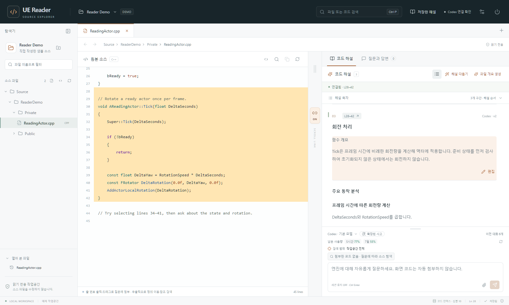
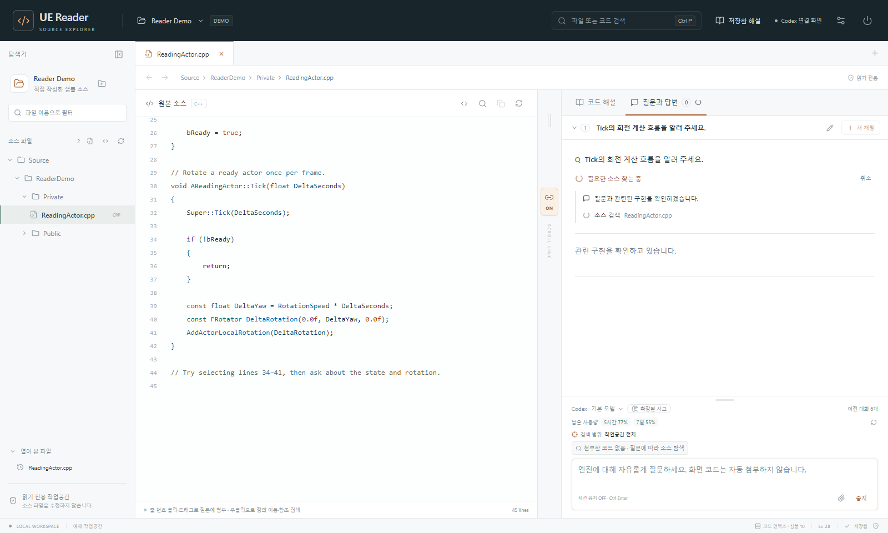
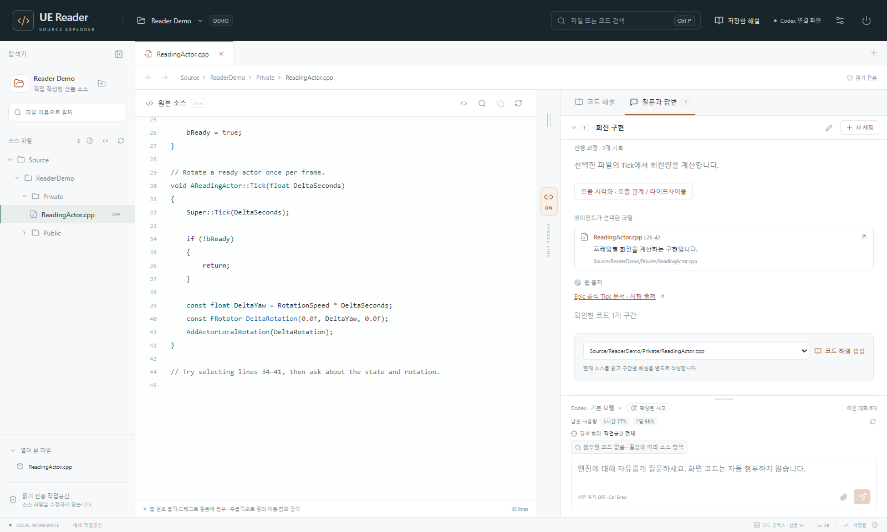
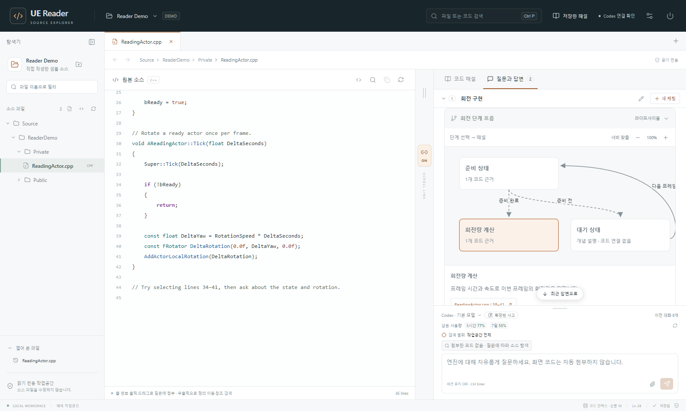
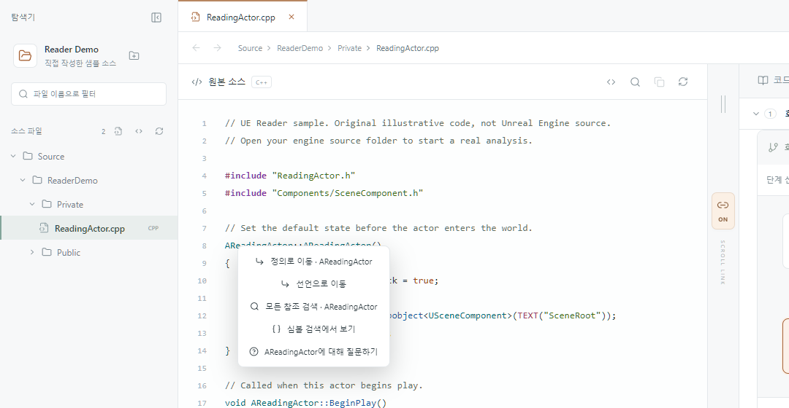
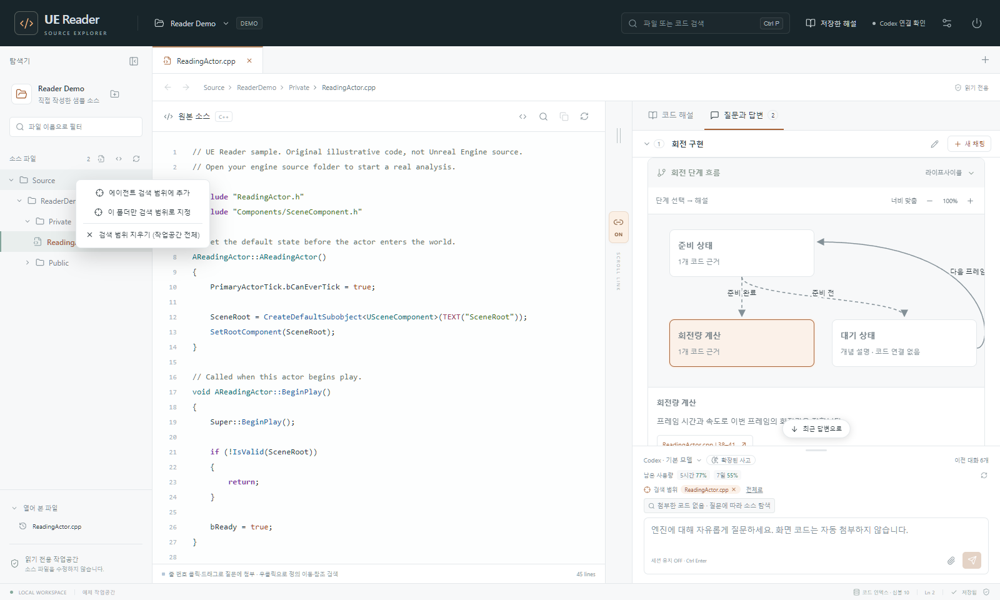
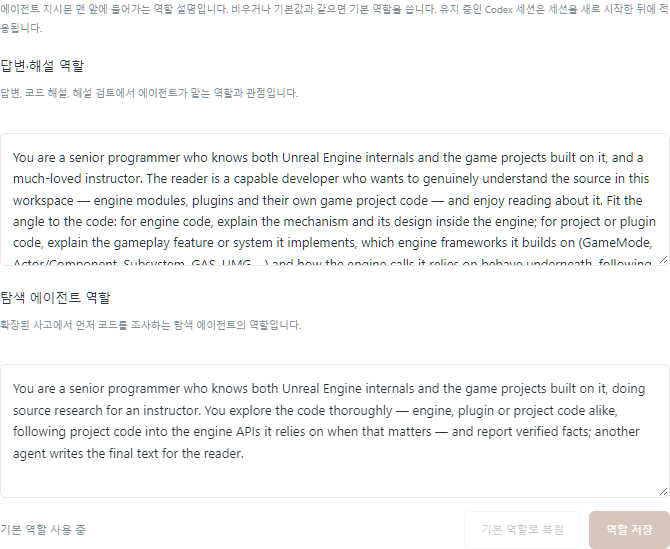

# UE Reader

**Unreal Engine 소스와 내 게임 프로젝트 코드를, AI 해설과 나란히 읽는 Windows 데스크톱 앱입니다.**

엔진이나 프로젝트 소스 폴더를 열면 왼쪽에는 원본 코드가, 오른쪽에는 AI 에이전트(Codex · Claude Code)가 실제로 읽고 쓴 해설과 답변이 나란히 표시됩니다. 에이전트는 직접 필요한 파일을 찾아 읽고, 검증된 코드 위치로만 해설을 연결합니다. 원본 소스는 읽기만 하며, 모든 데이터는 내 PC에 저장됩니다.



> 개발자·코딩 에이전트용 안내: 작업 규칙은 [`AGENTS.md`](AGENTS.md), 기능별 소스 위치는 [`Docs/CODE_INDEX.md`](Docs/CODE_INDEX.md), 자세한 화면 동작과 처리 한도는 [`Docs/사용-가이드.md`](Docs/사용-가이드.md)에 있습니다.

## 핵심 기능

### 코드 옆에서 읽는 강의형 해설
**파일 개요 생성**이나 **현재 코드 해설**을 누르면, 에이전트가 함수 단위로 무엇을 하는지와 왜 필요한지를 설명합니다. 해설은 원본 라인 순서가 아니라 이해하기 쉬운 **해설 순서**(진입점 → 핵심 함수 → 보조 함수)로 표시됩니다. 문장에 마우스를 올리면 해당 코드 범위가 강조되고, 스크롤하면 코드와 해설이 함께 움직입니다. 해설은 직접 편집할 수 있고, 여러 파일을 골라 **해설 다듬기**를 요청할 수도 있습니다. GC, 리플렉션, 델리게이트 같은 개발 용어는 직역하지 않습니다.

### 에이전트가 소스를 직접 찾아 읽는 질문 답변
파일을 열지 않아도 질문할 수 있습니다. 에이전트가 검색할 폴더를 스스로 정하고, 코드 인덱스로 심볼과 코드를 찾아 필요한 부분만 읽은 뒤 답합니다. 조사 과정은 실시간으로 표시되고, 답변에는 에이전트가 선택한 파일과 이유, 확인한 코드, 웹 출처가 함께 나옵니다. 질문과 답변은 채팅별로 저장되며, 채팅에서 "인벤토리 코드 해설 만들어 줘"처럼 요청하면 해설도 바로 만들어 줍니다.

| 조사 과정 실시간 표시 | 선택한 파일·근거가 붙은 답변 |
| --- | --- |
|  |  |

### 흐름 시각화
답변의 호출 흐름과 라이프사이클을 상호작용 다이어그램으로 그립니다. 단계를 누르면 설명과 검증된 코드 링크가 나옵니다.



### IDE처럼 탐색하는 코드 인덱스
작업공간을 열면 백그라운드에서 C++ 심볼 인덱스를 만듭니다(UE 5.6 엔진 소스 기준 처음 약 1분, 이후 약 10초). 코드를 우클릭해 **정의로 이동**, **선언으로 이동**, **모든 참조 검색**을 쓸 수 있고, **Ctrl+P**로 파일·코드를, **Ctrl+T**로 심볼을 찾습니다. 같은 인덱스를 에이전트도 사용합니다.



### 엔진 + 내 프로젝트, 그리고 검색 범위
한 작업공간에 엔진 소스와 내 프로젝트 폴더를 함께 열 수 있습니다. 탐색기 위쪽의 폴더+ 버튼으로 추가합니다. 프로젝트 코드를 물어보면 에이전트가 엔진 코드까지 따라가 읽습니다. 탐색기에서 폴더나 파일을 우클릭해 **에이전트 검색 범위**를 정하면, 에이전트가 그 안에서 먼저 찾습니다.



### 원하는 관점으로 조정하는 에이전트
**설정**에서 에이전트(Codex / Claude Code)와 모델을 고르고, 답변 말투와 형식을 정하는 **응답 지침**과 에이전트의 관점을 정하는 **에이전트 역할**을 직접 쓸 수 있습니다.



### 그 밖에
- **확장된 사고**: 탐색 에이전트가 먼저 넓게 조사하고, 해설은 검토 에이전트가 보충하고 다듬습니다.
- **문서와 첨부**: 작업공간 안의 PDF·Markdown 같은 기획 문서를 에이전트가 찾아 읽습니다. 작업공간 밖의 파일도 질문에 첨부할 수 있습니다.
- **세션 유지**: 채팅마다 에이전트 세션을 이어 가고, 남은 사용량(Codex)도 표시합니다.
- **읽기 환경**: 밝게·어둡게 테마, 글꼴과 글자 크기, 탭 관리, 탐색 기록(Alt+←/→), 작업공간별 화면 상태 저장을 지원합니다.

## 요구 사항

| 항목 | 내용 |
| --- | --- |
| 운영체제 | Windows 10 / 11 (x64) |
| AI 에이전트 | [Codex CLI](https://learn.chatgpt.com/docs/non-interactive-mode) 또는 Claude Code CLI 중 하나 이상, 그리고 로그인된 계정. 별도 API 키는 필요하지 않습니다. |
| 빌드 | Node.js 20.18 이상 (소스에서 앱을 만들 때) |
| 분석할 소스 | Unreal Engine 소스 폴더, 게임 프로젝트 폴더 또는 C++ 소스 폴더 |

## 설치

이 저장소 폴더에서 PowerShell을 열고 실행합니다.

```powershell
npm ci                     # 의존성 설치
npm run package:desktop    # 데스크톱 앱 빌드 → release\win-unpacked
.\install-shortcuts.cmd    # 바탕화면에 UE Reader 바로가기 만들기
```

빌드된 앱은 `release\win-unpacked\UE Reader.exe`입니다. 다른 위치로 옮길 때는 `win-unpacked` 폴더를 통째로 옮기세요. 다시 빌드할 때는 실행 중인 UE Reader를 먼저 종료합니다. 실행 중이면 파일이 잠겨 빌드 검사가 실패합니다.

### 에이전트 로그인

앱은 PC에 설치된 CLI와 이미 로그인된 계정을 그대로 사용합니다.

```powershell
codex login     # Codex
claude          # Claude Code: 실행 후 /login
```

로그인한 뒤 앱의 **설정 → AI 에이전트와 모델**에서 에이전트를 고르고 **확인**으로 연결 상태를 점검합니다.

## 실행과 첫 사용

1. 바탕화면의 **UE Reader**를 실행합니다. 또는 `release\win-unpacked\UE Reader.exe`를 직접 실행합니다.
2. **소스 폴더 열기**에서 엔진 소스 경로(예: `D:\UnrealEngine\Engine\Source`)나 분석할 프로젝트 폴더를 붙여 넣습니다. 먼저 둘러보려면 **예제로 둘러보기**를 누릅니다.
3. (선택) 탐색기 위쪽의 폴더+ 버튼으로 내 프로젝트 폴더를 추가합니다.
4. 오른쪽 입력창에 질문하거나(Ctrl+Enter), 파일을 열고 **파일 개요 생성**·**현재 코드 해설**을 누릅니다. 줄 번호를 클릭·드래그하면 그 범위를 질문에 첨부할 수 있습니다.
5. 창의 **X** 또는 오른쪽 위 **앱 종료**로 끝냅니다. 질문 초안과 화면 상태는 자동 저장됩니다.

소스 폴더 없이 일반 질문만 할 수도 있습니다(**일반 질문 열기**).

## 소스 보호와 데이터

- 원본 소스는 **읽기 전용**입니다. 에이전트는 앱이 제공하는 읽기 전용 소스 도구와 웹 검색만 쓸 수 있고, 셸·파일 쓰기·플러그인은 사용할 수 없습니다.
- 해설과 근거는 에이전트가 **실제로 읽은 코드 범위**로만 저장됩니다. 확인하지 않은 위치는 버리고 경고로 남깁니다.
- 내장 서버는 `127.0.0.1`에만 열리며 외부 요청을 거부합니다.
- 앱 데이터는 `%LOCALAPPDATA%\UEReader`에 저장됩니다. 경로는 `UE_READER_DATA` 환경 변수로 바꿀 수 있습니다. 질문할 때는 선택한 코드와 에이전트가 읽은 코드가 해당 에이전트 서비스로 전달됩니다.

## 개발

```powershell
npm run desktop        # 개발 중인 데스크톱 앱 실행
npm run dev            # 개발용 브라우저 서버
npm test               # 서버 코어·채팅·에이전트 시험 (실제 CLI 호출 없음)
npm run build          # 타입 검사 + 프런트엔드 빌드
npm run test:ui        # Microsoft Edge UI 시험 (포트 4318, 임시 데이터)
npm run test:desktop   # Electron 스모크 시험
```

| 환경 변수 | 용도 |
| --- | --- |
| `UE_READER_DATA` | 앱 데이터 폴더 |
| `PORT` | 서버 포트 (기본 `4317`) |
| `CODEX_BIN` / `CLAUDE_BIN` | 에이전트 실행 파일 경로 (미지정 시 자동 탐색) |
| `CODEX_MODEL` | 앱에 저장한 모델 설정이 없을 때의 Codex 초기 모델 |

구조는 Electron 창 + Express 내장 서버(`server/`) + React UI(`src/`)입니다. 기능별 진입점은 [`Docs/CODE_INDEX.md`](Docs/CODE_INDEX.md)를 보세요.

## 문서

- [사용 가이드](Docs/사용-가이드.md): 화면 동작, 에이전트 연결 방식, 세션, 저장 규칙, 처리 한도
- [코드 인덱스](Docs/CODE_INDEX.md): 기능별 소스 파일 지도
- [기획서](Docs/기획서.md): 기획 배경
- [분석 개선 기록](Docs/분석-개선-2026-10-09.md): 실제 사용 기록으로 본 해설 품질 개선

예제 작업공간은 직접 작성한 액터 코드입니다. Unreal Engine 원본 소스를 포함하지 않습니다.
